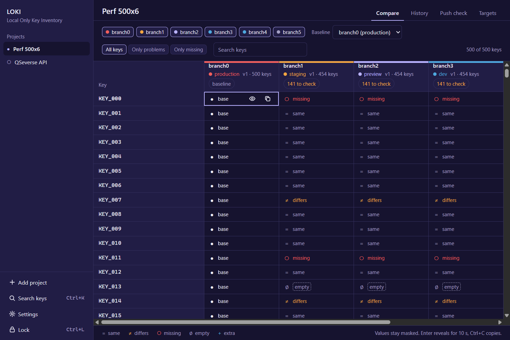

# LOKI — Local Only Key Inventory

An encrypted, offline inventory of your `.env` files across projects, branches and deployment
stages, for Windows. It answers the push-day question fast:

> **What is different between staging and production, and what is missing?**

LOKI never touches the network. Your values are encrypted on your machine with a master password
that is never stored, and the app works with the network cable pulled.



## Features

- **Compare matrix.** Rows are keys, columns are targets (branch + stage). Every cell says
  `same`, `differs`, `missing`, `empty` or `extra` against a baseline, without decrypting
  anything: equality comes from HMAC fingerprints. Keyboard first, and smooth with 500 keys × 6
  targets.
- **Push-day check.** Staging → production findings: missing keys, required keys, `localhost` or
  test API keys in production, secrets shared across stages, `DEBUG=true`. Rules can be switched
  off or extended. Export a Markdown checklist (keys only, never values).
- **Overview.** Release readiness for every project, drift (which `.env` files on disk changed
  since you imported them) and rotation reminders.
- **Diff checker.** Compare real values between a target, a version, a file or pasted text, with
  character-level highlighting. Values appear only when you ask, and hide again on a timer.
- **Versions.** Every import is an immutable snapshot. Diff any two, restore, re-import a changed
  file in one click.
- **Passwords.** A small password store for the logins that are not in a `.env` (database
  consoles, cloud root accounts, registrars), with weak and reused password detection.
- **Secure share.** Hand a `.env` to a teammate as an encrypted `.lokishare` file that opens only
  with a one-time pass key.
- **Import from anywhere.** Pick a file, drop it, paste it, or scan a project folder (stage
  guessed from the file name, branch read from `.git/HEAD`).
- **Export** a full `.env`, a `.env.example`, or just the keys production is missing.
- **Encrypted backups**, an audit log of every reveal, copy and export, auto-lock, and an option
  to hide the window from screenshots and screen sharing.

| Overview | Diff checker | Passwords |
|---|---|---|
|  |  |  |

## Security in one paragraph

Argon2id (64 MiB, 3 passes) turns your master password into two keys: one for
XChaCha20-Poly1305 encryption of every value, one for HMAC-SHA256 fingerprints. Each value has a
fresh random nonce and is bound to its row, so ciphertexts cannot be swapped. The interface
receives key names, statuses and fingerprints; a value reaches it only when you click Reveal, and
every reveal is logged. Copies go to the clipboard from the Rust core, stay out of Windows
clipboard history and clear themselves. Details, limits and how to report a problem:
[SECURITY.md](SECURITY.md).

## Install

Download the installer from the [Releases](../../releases) page, or the Microsoft Store (coming
soon). Requires Windows 10 or 11; the installer includes WebView2 for offline machines.

Your vault lives in `%LOCALAPPDATA%\LOKI\loki.db`. Uninstalling LOKI never removes it.

## Build from source

Requirements: Node.js 20+, Rust (stable), and the Visual Studio C++ Build Tools.

```powershell
npm install
npm run tauri dev        # run in development
npm run tauri build      # installers in src-tauri\target\release\bundle
```

Checks that run in CI:

```powershell
npm test                 # Vitest
npm run lint
npm run size             # frontend size budget
npm run check:offline    # fails if anything in the production build could open a socket
cd src-tauri; cargo test; cargo clippy --all-targets -- -D warnings
```

To try LOKI without touching your real vault, set `LOKI_DATA_DIR` to a scratch folder.

## Privacy

LOKI collects nothing and sends nothing. See [PRIVACY.md](PRIVACY.md).

## License

[Apache License 2.0](LICENSE). Copyright 2026 Sainath Belagavi. The Exo 2 font is bundled under
the SIL Open Font License; see [NOTICE](NOTICE).

LOKI stands for Local Only Key Inventory. It is an independent project and is not affiliated with
any other product or company that uses the name Loki.
