<div align="center">


# LOKI

**Local Only Key Inventory**

An encrypted, offline home for every `.env` file you own, built for the day you push to production.

[](https://github.com/saibelagavi/loki/actions/workflows/ci.yml)
[](LICENSE)


[Features](#features) · [Install](#install) · [Security](#security) · [Build from source](#build-from-source) · [Contributing](#contributing)

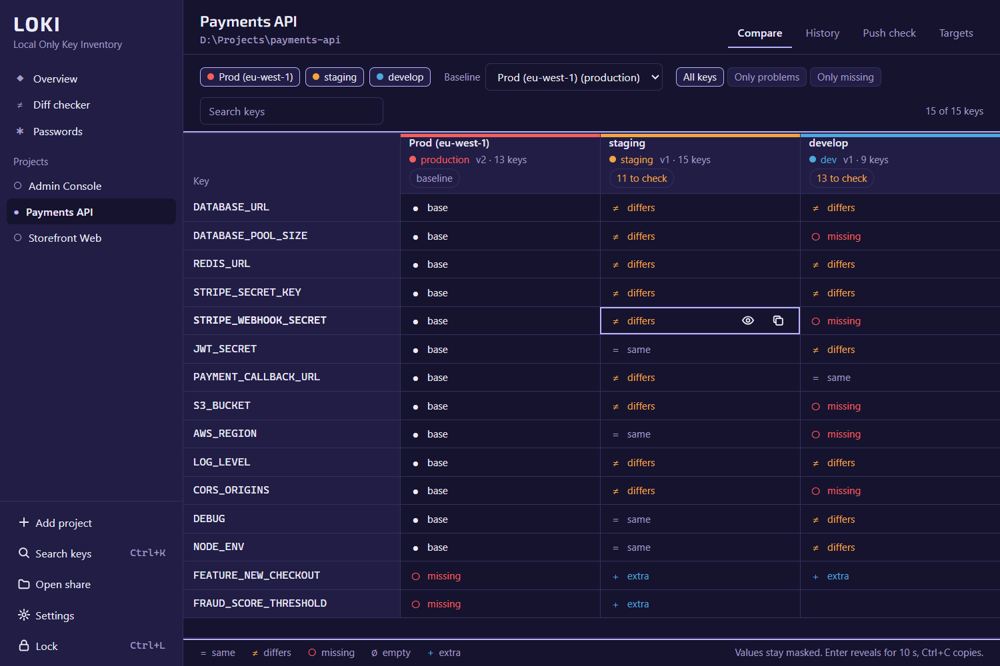

</div>

---

## Why LOKI

On release day you open five `.env` files side by side and hunt, by eye, for the key staging has and
production forgot, the `sk_test_` key that slipped into production, the `localhost` URL nobody
noticed. LOKI does that hunt for you, and answers one question fast:

> **What is different between staging and production, and what is missing?**

- **Offline by design.** No network code at all. It works with the cable pulled.
- **Encrypted at rest.** Argon2id + XChaCha20-Poly1305; your master password is never stored.
- **Masked by default.** You see which values differ, not the values themselves, until you ask.
- **Small and fast.** A ~5 MB app that opens in under half a second.

## Features

### 🧭 Push-day overview
Every project on one screen: which ones would ship with keys missing in production, which `.env`
files on disk changed since you last imported them (one click to re-import), and which secrets
and passwords are overdue for rotation.

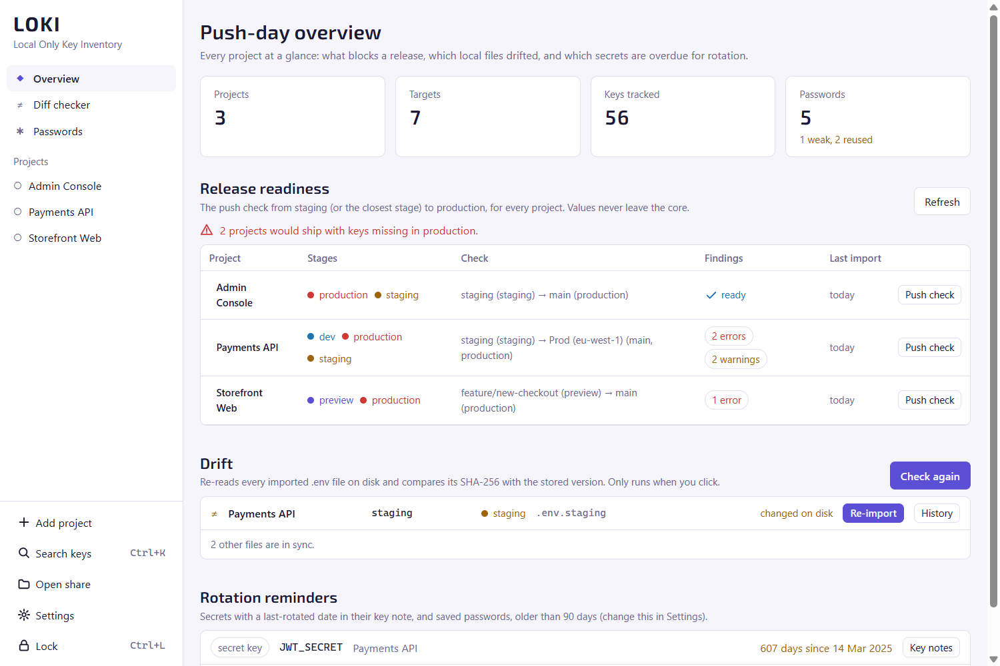

### 🔲 Compare matrix
Rows are keys, columns are your targets (branch + stage), one column is the baseline. Every cell
says `= same`, `≠ differs`, `○ missing`, `∅ empty` or `+ extra`, computed from encrypted
fingerprints without decrypting anything. Sticky headers, filters, search, full keyboard control
(arrows, <kbd>Enter</kbd> to reveal, <kbd>Ctrl</kbd>+<kbd>C</kbd> to copy), and smooth with
500 keys × 6 targets.

### ✅ Push-day check
Pick *from* and *to* (say staging → production) and get findings grouped by severity:

| Severity | What it catches |
|---|---|
| **Error** | keys missing in the target; keys marked required for that stage but missing or empty |
| **Warning** | `localhost`, `127.0.0.1` or `example.com` in production; `sk_test_` / `pk_test_` keys in production; placeholder words; a secret shared between production and another stage; `DEBUG=true` or `NODE_ENV=development` |
| **Info** | keys that exist only in the target (possibly stale) |

Switch rules off or add your own, then export a Markdown checklist (keys only, never values) or
just the missing keys to paste into your deploy platform.

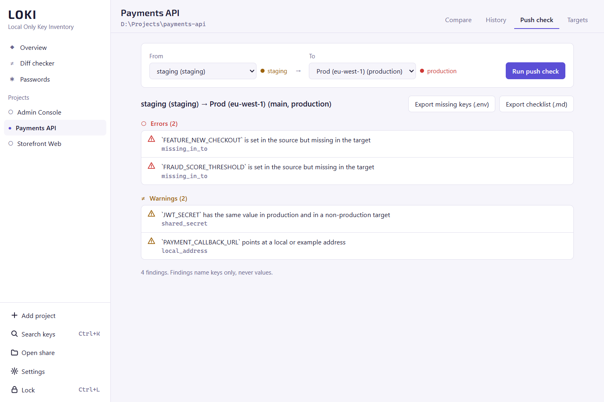

### ≠ Diff checker
Compare **real values** between any two sources: a target, a specific version, a `.env` file on
disk, or pasted text, even across projects. LOKI first tells you what differs and hints like
*"only a trailing slash differs"*. Values appear only when you ask, with character-level
highlighting, and hide again on a visible countdown.

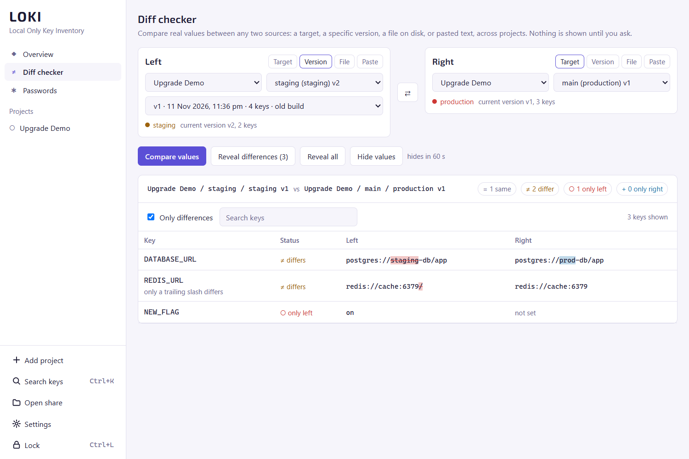

### 🕓 Versions and history
Every import is an immutable version. Diff any two versions (added, removed, changed), restore an
old one as a new version, or re-import a file in one click (skipped if its SHA-256 is unchanged).

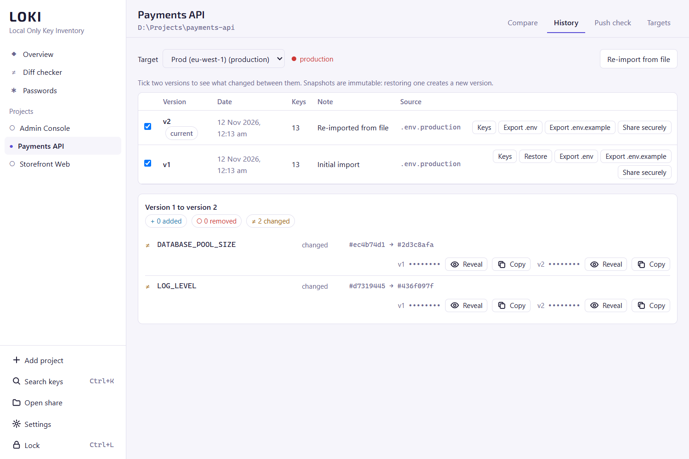

### 🔑 Passwords
A small password store for logins that are not in a `.env`: database consoles, cloud root
accounts, DNS, payment dashboards. Weak and reused passwords are flagged, a generator is built
in, and copies stay out of Windows clipboard history and clear themselves.

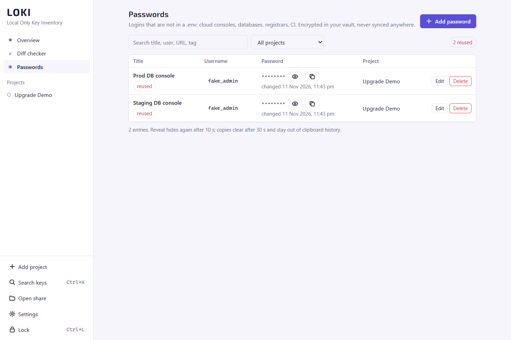

### 🔍 Search across projects
<kbd>Ctrl</kbd>+<kbd>K</kbd>: *where is `REDIS_URL` used, and is it the same everywhere?* Pick a
result to jump straight to that cell in the compare matrix, highlighted.

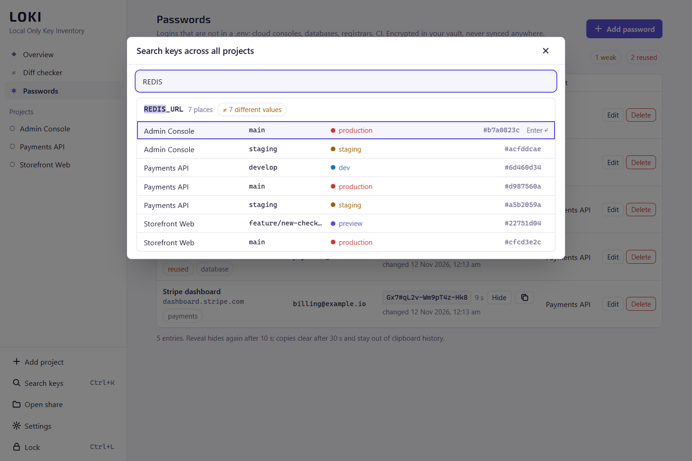

### 📦 Secure share: hand over `.env` files safely
Onboarding a teammate, or moving to a new laptop? Bundle **whole projects, single `.env` files,
or just some keys** into one encrypted `.lokishare` file that opens only with a one-time pass key.
No server, no account, no copy-pasting secrets into chat.

**Sending** takes three steps (**Share .env files** in the left rail, or **Share** on any target):

1. **Choose** what goes in. Tick projects or individual `.env` files, from any project, and use
   *All keys ▾* to leave out what the recipient should not get (here, the live Stripe key).
2. **Pass key.** LOKI generates it (25 characters, 125 bits) and shows it *before* the file exists,
   with **Copy** and **New key**. You cannot create the file until you have copied it, so it never
   gets lost. LOKI does not keep it. Optionally set an expiry and a note.
3. **Send.** Save the file, then follow the guide: the file one way (email, Slack, a drive), the
   pass key another way (a chat, a call, in person).

| 1. Choose | 2. Pass key | 3. Send |
|---|---|---|
| 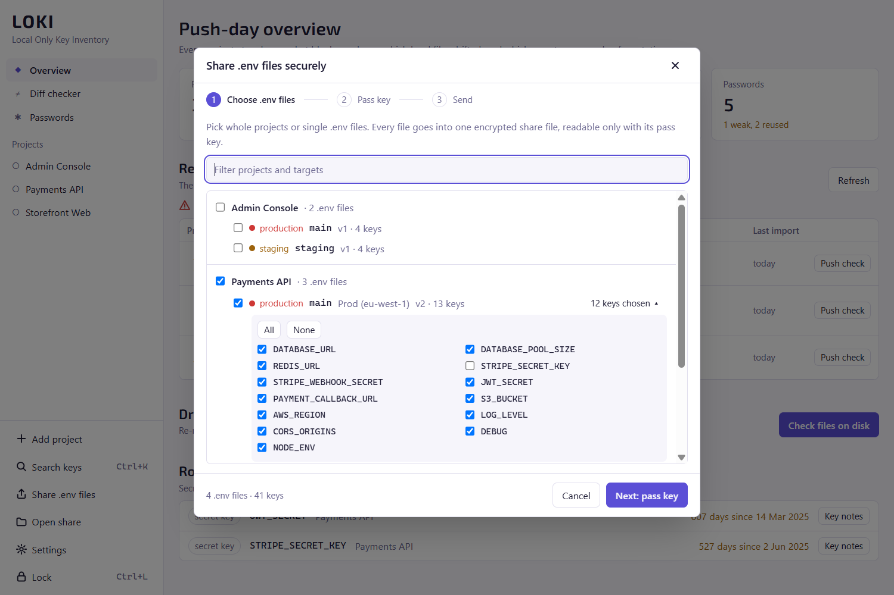 | 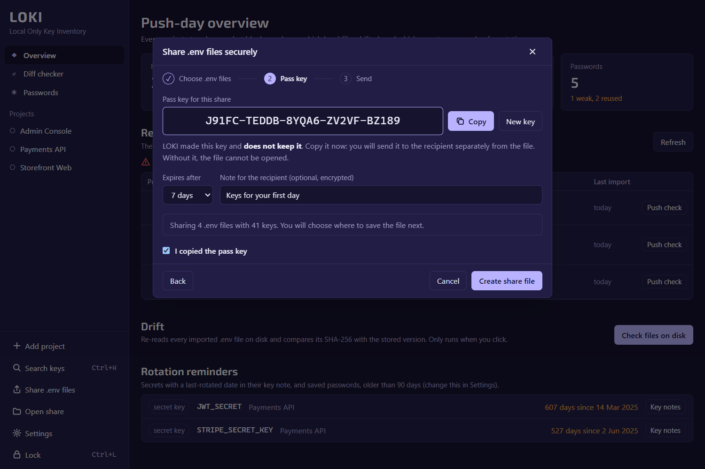 | 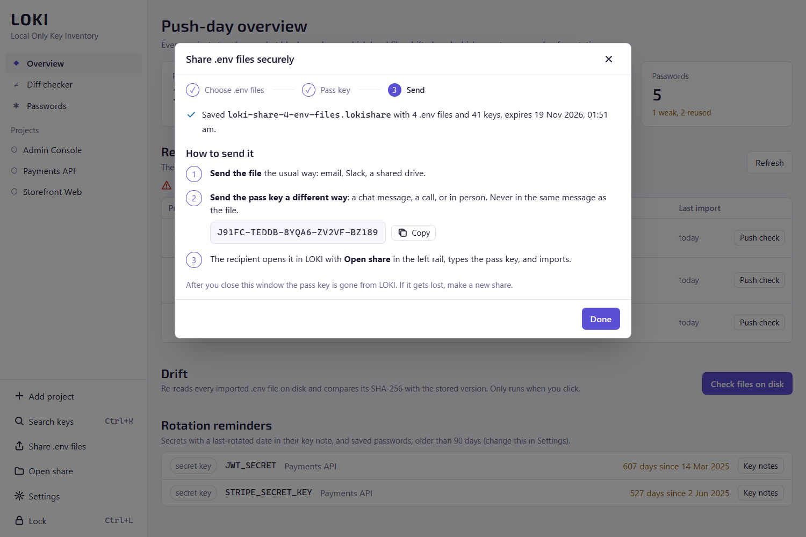 |

**Receiving:** **Open share**, choose the file, type the pass key. You see key names only, never
values, and each `.env` already points at its own project and target: an existing one gets a new
version (nothing is overwritten), a missing one is created. One click imports everything, or save
any single file as a plain `.env`.

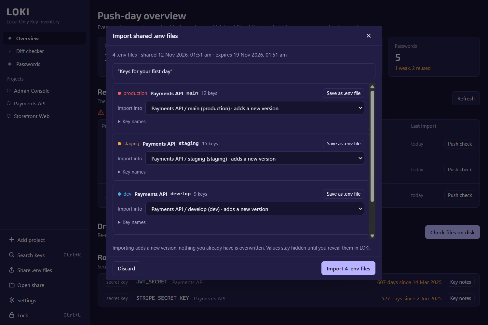

Under the hood: Argon2id + XChaCha20-Poly1305, the same as LOKI's vault; the file is tamper-proof,
and without the pass key not even the project names are readable. Expiry is enforced by LOKI when
importing. See [SECURITY.md](SECURITY.md#backups-and-shares).

### And also
- **Import from anywhere:** pick a file, drop it on the window, paste it, or scan a project folder
  (stage guessed from the file name, branch read straight from `.git/HEAD`).
- **Export** a full `.env`, a `.env.example` (keys and comments, values blank), or only the keys
  production is missing.
- **Key notes:** what a key is for, which stages require it, when it was last rotated.
- **Encrypted `.loki` backups** under their own password, including passwords.
- **Audit log** of every reveal, copy, export, share and delete (key names only, never values).
- **Auto-lock** when idle or minimized, and an option to hide the window from screenshots and
  screen sharing.
- **Dark and light themes** that follow Windows, WCAG AA contrast, full keyboard use.

<table>
<tr>
<td>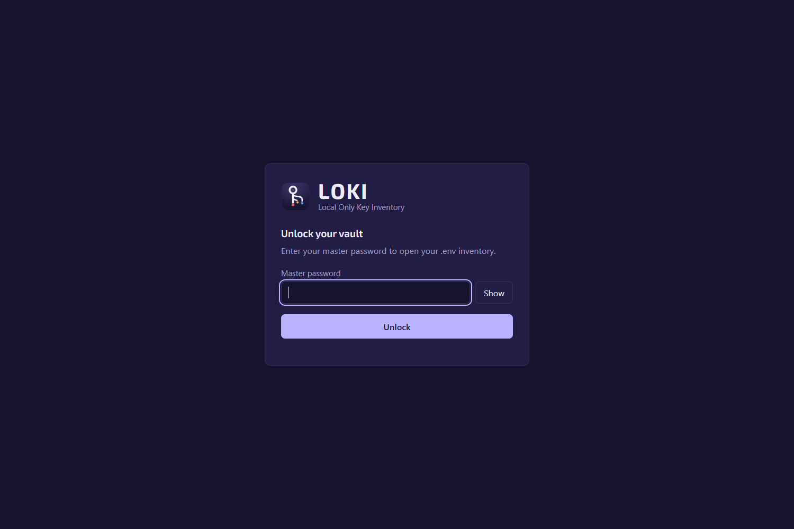</td>
<td>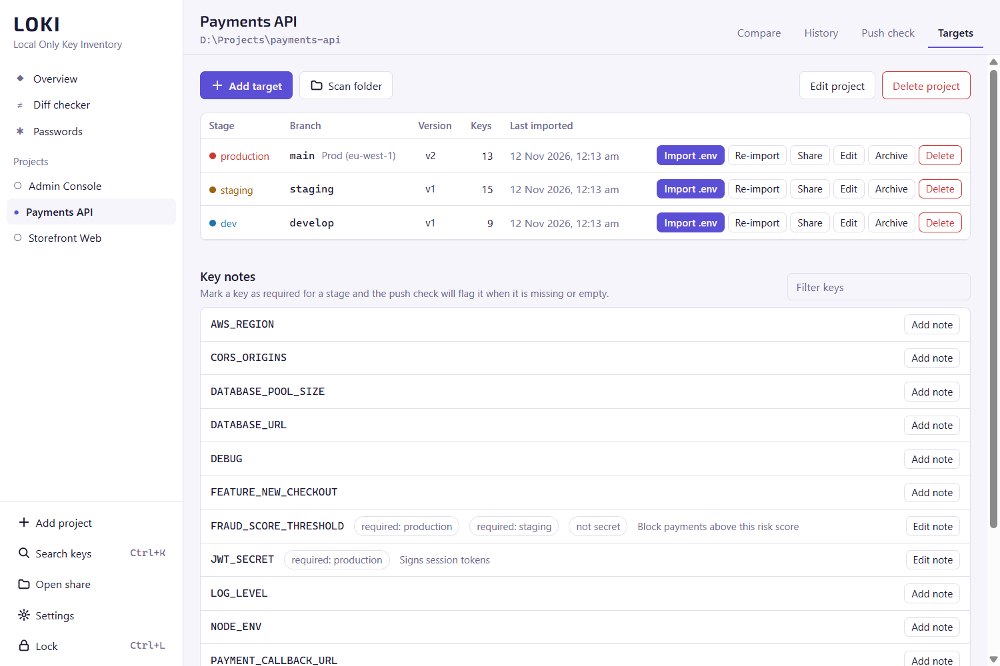</td>
</tr>
</table>

## Install

1. Download `LOKI_x.y.z_x64-setup.exe` (or the `.msi`) from the
   [latest release](https://github.com/saibelagavi/loki/releases/latest). A Microsoft Store
   listing is on the way.
2. Run it. Windows SmartScreen may warn because the installer is not code-signed yet: choose
   **More info → Run anyway** only if you downloaded it from this repository's Releases page.
3. Open LOKI and choose a master password. **Remember it: LOKI cannot recover it.**
4. Add a project, then import its `.env` files, or use **Scan folder** on the project directory.

Works on Windows 10 and 11. The installer includes WebView2, so offline machines are fine.
Your vault lives in `%LOCALAPPDATA%\LOKI\loki.db` (Settings → Your data shows the folder).
Uninstalling or reinstalling LOKI never deletes it; to remove everything, uninstall LOKI and then
delete that folder.

## Security

Argon2id (64 MiB, 3 passes) turns your master password into two keys: one encrypts every value
with XChaCha20-Poly1305 (fresh nonce, bound to its row), the other computes HMAC-SHA256
fingerprints so LOKI can tell *whether* values match without decrypting them. The interface gets
key names, statuses and fingerprints; a value reaches it only when you click Reveal, and every
reveal is logged. A build check fails if anything in the app could open a network socket.

Full design, limits and how to report a vulnerability privately: **[SECURITY.md](SECURITY.md)**.
LOKI collects nothing: **[PRIVACY.md](PRIVACY.md)**.

## Build from source

Requirements: Windows 10 or 11, [Node.js](https://nodejs.org) 20+, [Rust](https://rustup.rs)
(stable), and the Visual Studio C++ Build Tools.

```powershell
git clone https://github.com/saibelagavi/loki.git
cd loki
npm install
$env:LOKI_DATA_DIR = "$env:TEMP\loki-dev"   # try it on a scratch vault, not your real one
npm run tauri dev                           # run in development
npm run tauri build                         # installers in src-tauri\target\release\bundle
```

The checks CI runs on every push:

```powershell
npm run lint; npm test; npm run build; npm run size; npm run check:offline
cd src-tauri; cargo clippy --all-targets -- -D warnings; cargo test --lib
```

**Stack:** Tauri 2 · Rust (RustCrypto, SQLite) · React · TypeScript · Tailwind CSS.

## Contributing

Bug reports, ideas and pull requests are welcome. Fork the repository and open a pull request;
for a new feature, please open a feature request first so we can agree on it. Every change is
reviewed and merged by the maintainer. See **[CONTRIBUTING.md](CONTRIBUTING.md)** and the
[Code of Conduct](CODE_OF_CONDUCT.md).

## License

[Apache License 2.0](LICENSE) © 2026 Sainath Belagavi. The bundled Exo 2 font is under the SIL
Open Font License; see [NOTICE](NOTICE).

LOKI stands for *Local Only Key Inventory*. It is an independent project and is not affiliated with
any other product or company that uses the name Loki.
